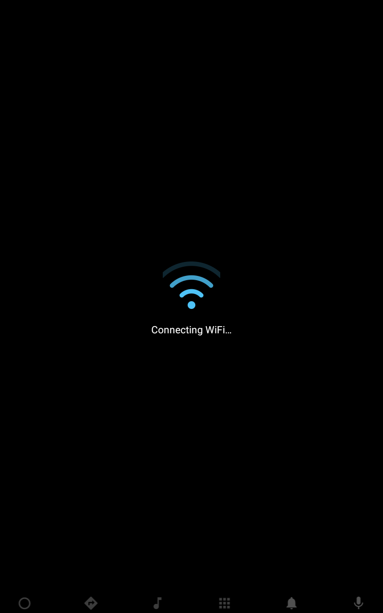
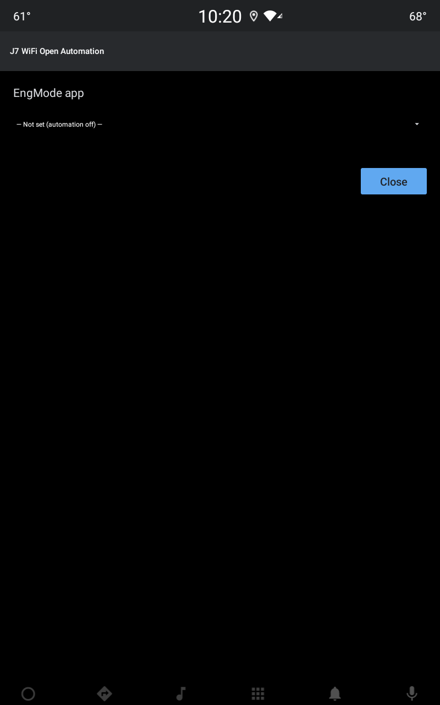
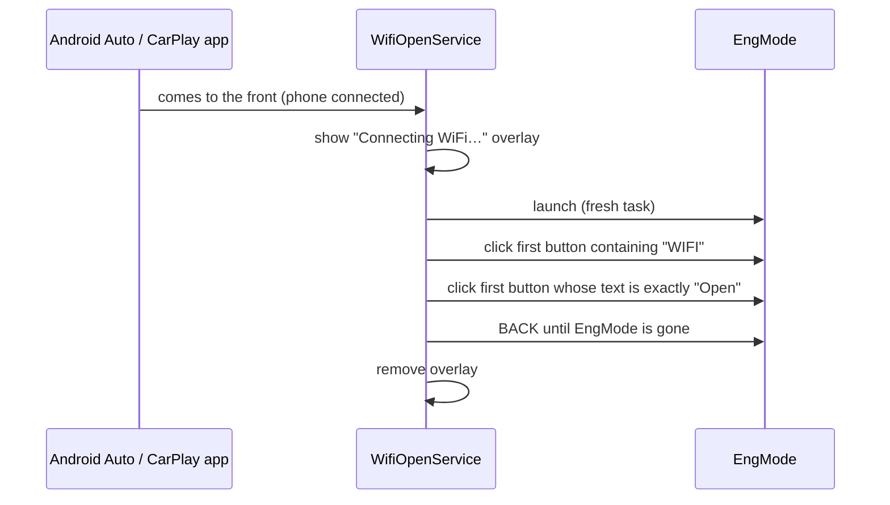

# J7 WiFi Open Automation

[](https://github.com/carlosrpg/J7WifiOpenAutomation/actions/workflows/build.yml)
-3DDC84?logo=android&logoColor=white)


**Plug in your phone, get WiFi. No tapping through engineering menus.**

On the Jaecoo J7 head unit, wireless Android Auto / CarPlay needs a WiFi toggle that lives deep inside the
hidden **EngMode** app, and it resets. This app is a tiny accessibility service that watches the head unit's
**Android Auto** and **CarPlay** apps. The moment one of them comes up, it opens EngMode, taps **WIFI**, taps
**Open**, and closes EngMode.
A "Connecting WiFi…" screen covers it all, so you never see the menus.

<p align="center">
  
  &nbsp;&nbsp;
  
</p>

> [!WARNING]
> This drives a manufacturer engineering menu. Use it at your own risk, and only configure it while parked.

## How it works



- **Watches two packages:** `com.google.android.projection.sink` (Android Auto) and
  `com.desaysv.vehicle.carplayapp` (CarPlay).
- **At most once every 10 minutes.** Neither app tells other apps "a phone connected", so the service runs when
  one comes to the front and then holds off for `COOLDOWN_MS`. Returning from EngMode or switching apps mid-drive
  never re-runs it.
- **Hidden behind an overlay.** Accessibility clicks reach EngMode underneath a full-screen accessibility overlay,
  so EngMode never shows. (Running it truly off-screen would need system privileges.)
- **Fails safe.** If a button isn't found within 15 s, it gives up, closes EngMode and removes the overlay.
- **Zero dependencies.** Plain Android framework, about 250 lines of Kotlin.

## Install on the car

1. Download the latest `J7WifiOpen-<version>.apk` from [Releases](https://github.com/carlosrpg/J7WifiOpenAutomation/releases).
2. Install it and enable the accessibility service over adb. Android Automotive usually has no Accessibility
   page in Settings, and it already enables its own services, so **append** to the list instead of replacing it:

   ```bash
   adb install -r J7WifiOpen-1.0.0.apk
   ```
   ```bash
   adb shell settings get secure enabled_accessibility_services
   ```
   ```bash
   adb shell settings put secure enabled_accessibility_services "<value from above>:com.carlosrpg.wifiopen/.WifiOpenService"
   ```
   ```bash
   adb shell settings put secure accessibility_enabled 1
   ```

3. Open **J7 WiFi Open Automation** from the app grid. It preselects the app whose name or package loosely
   matches `engmode`. Check it, then tap **Close**. The service does nothing until EngMode is set.

Uninstalling the app removes it from `enabled_accessibility_services`, so repeat step 2 after a reinstall
that changes the signature.

## Tuning for your head unit

The watched packages (`PROJECTION_PKGS`) and the cooldown (`COOLDOWN_MS`) are at the top of
[`WifiOpenService.kt`](app/src/main/java/com/carlosrpg/wifiopen/WifiOpenService.kt). Every window change is
logged, so connect a phone and look:

```bash
adb logcat -s J7WifiOpen
```

```text
D J7WifiOpen: window pkg=com.google.android.projection.sink cls=...
I J7WifiOpen: Projection connected, running EngMode WiFi automation
I J7WifiOpen: click 'WIFI' -> true
I J7WifiOpen: click 'Open' -> true
I J7WifiOpen: Done
```

| Problem | Where to look |
|---|---|
| No `window pkg=` lines at all | The service isn't running: check `adb shell dumpsys accessibility` and step 2 |
| `window` lines, but none from the projection apps | The projection app's package differs, or it draws on another display; add what logcat shows to `PROJECTION_PKGS` |
| `EngMode is not set` | Open the app and pick EngMode |
| Stuck on the overlay for 15 s | EngMode's button text differs from `WIFI` / `Open`; check the `click` lines in logcat |

## Build

Requirements: JDK 17+ (21 recommended) and Android SDK platform 37.

```bash
./gradlew assembleDebug testDebugUnitTest
```

Release signing reads `RELEASE_STORE_FILE`, `RELEASE_STORE_PASSWORD`, `RELEASE_KEY_ALIAS` and
`RELEASE_KEY_PASSWORD` from a Gradle property, then `local.properties`, then environment variables. Without a
keystore, `assembleRelease` still builds, just unsigned. Keystores and `local.properties` are git-ignored.

```bash
./gradlew assembleRelease
```

## CI and releases

[`.github/workflows/build.yml`](.github/workflows/build.yml) runs the unit tests and builds the APK on every push
and pull request. Pushing a `vX.Y.Z` tag builds a signed APK and publishes it as a GitHub release:

```bash
git tag v1.0.0
```
```bash
git push origin v1.0.0
```

Signed builds need these repository secrets:

| Secret | Value |
|---|---|
| `RELEASE_KEYSTORE_BASE64` | `base64 -w0 release.keystore` |
| `RELEASE_STORE_PASSWORD` | keystore password |
| `RELEASE_KEY_ALIAS` | key alias |
| `RELEASE_KEY_PASSWORD` | key password |

## Project layout

```text
app/src/main/java/com/carlosrpg/wifiopen/
├── WifiOpenService.kt     accessibility service: detection, EngMode automation, overlay
├── ConnectionTrigger.kt   cooldown that stops repeat runs (unit tested)
├── WifiAnimationView.kt   animated WiFi symbol for the overlay
└── SettingsActivity.kt    EngMode package picker
```
